# Hello World Remote MCP Server & Static-IP Agent Engine Deployment

A minimal remote Model Context Protocol (MCP) server built with [FastMCP](https://github.com/jlowin/fastmcp) using the **Streamable HTTP** transport (`/mcp`), paired with an ADK agent (`hello-mcp-agent/`) and a **Terraform-managed deployment (`manage-static-agent`)** that deploys the agent to **Vertex AI Agent Engine** with a **guaranteed Static Outbound IP** for all calls to the remote MCP server.

---

## Quick Start: Remote MCP Server (Assumed Running Externally)

```bash
uv sync
uv run server.py
```

The server listens on `http://0.0.0.0:8080/mcp` by default and exposes two tools:
- `hello(name)` — Returns a greeting.
- `hello_from_ip(name)` — Returns a greeting together with the caller's source IP address as observed by the MCP server.

---

## Static-IP Agent Engine Architecture

### The Networking Challenge

1. **Dynamic Outbound IPs by Default**: Vertex AI Agent Engine (`google_vertex_ai_reasoning_engine`) runs inside a Google-managed tenant project (`*-tp`). By default, outbound internet requests from an agent to external tools or Model Context Protocol (MCP) servers originate from shared, ephemeral Google IP pools—making IP-based firewall allowlisting on the remote MCP server impossible.
2. **RFC 1918 Routing Limitation on PSC Interfaces**: When you attach a Vertex AI Agent Engine to your VPC using **Private Service Connect (PSC) Interface** (`psc_interface_config`), the managed runtime injects a virtual network interface into your VPC's PSC subnet (`192.168.10.0/28`). However, **Agent Engine only routes RFC 1918 private IP destinations (`10.0.0.0/8`, `172.16.0.0/12`, `192.168.0.0/16`) through the PSC Interface**. Traffic addressed directly to a public internet IP (such as `35.186.182.189`) bypasses the PSC Interface and exits directly through Google's tenant network with a dynamic IP.

### Architectural Solution: PSC Interface + Internal Egress Proxy + Cloud NAT

To force all MCP tool calls through a **single, deterministic, customer-owned Static External IP**, the Terraform stack in [`terraform/`](terraform/) bridges the Agent Engine PSC Interface to an internal RFC 1918 Layer-7 HTTP/HTTPS Egress Proxy inside your consumer VPC, which in turn exits to the internet through **Cloud NAT** pinned to a reserved `google_compute_address`:

```mermaid
flowchart LR
    subgraph Tenant["Google-Managed Tenant Project"]
        AE["Vertex AI Agent Engine<br/>(ADK Agent + McpToolset)<br/>MCP_PROXY_URL=http://10.10.10.2:8888"]
    end

    subgraph VPC["Customer VPC (hello-mcp-static-vpc)"]
        PSC_ATT["PSC Network Attachment<br/>(hello-mcp-static-psc-attachment)"]
        PSC_SUB["PSC Subnet<br/>(192.168.10.0/28)"]
        DNS["Cloud DNS Private Zone<br/>(proxy.mcp.internal. -> 10.10.10.2)"]
        PROXY["Egress Proxy VM (10.10.10.2:8888)<br/>(No External IP, Shielded VM,<br/>can_ip_forward = false)"]
        NAT["Cloud Router + Cloud NAT<br/>(MANUAL_ONLY NAT Allocation)"]
        STATIC_IP["Reserved Static External IP<br/>(google_compute_address)"]
    end

    subgraph External["External Network / Cloud"]
        MCP["Remote MCP Server<br/>(e.g. http://35.186.182.189:8080/mcp)"]
    end

    AE -->|"1. RFC 1918 HTTP Proxy Request<br/>(to 10.10.10.2:8888)"| PSC_ATT
    PSC_ATT --> PSC_SUB
    PSC_SUB -.->|"DNS Peering"| DNS
    PSC_SUB -->|"2. Internal VPC Routing<br/>(Firewall: TCP 8888)"| PROXY
    PROXY -->|"3. Outbound TCP to MCP URL"| NAT
    NAT -->|"4. SNAT to Static IP"| STATIC_IP
    STATIC_IP -->|"5. Arrives from Static IP"| MCP
```



### End-to-End Packet & Request Flow

1. **Agent Proxy Configuration (`MCP_PROXY_URL`)**: During deployment, Terraform injects `MCP_PROXY_URL=http://10.10.10.2:8888` and `MCP_SERVER_URL=<remote-mcp-url>` into the Agent Engine container environment ([`terraform/agent.tf`](terraform/agent.tf)). Inside [`hello-mcp-agent/app/agent.py`](hello-mcp-agent/app/agent.py), `McpToolset` is configured with a custom `httpx_client_factory` (`google.adk.dependencies._httpx.AsyncClient`) that routes all MCP Streamable-HTTP / SSE requests through `http://10.10.10.2:8888`.
2. **PSC Interface Traversal**: Because the proxy destination (`10.10.10.2`) is an RFC 1918 private address, the Agent Engine runtime routes the packet out of the Google tenant project through the **PSC Network Attachment** (`hello-mcp-static-psc-attachment`) into the consumer VPC's **PSC Subnet** (`192.168.10.0/28`).
3. **Internal VPC Forwarding (`192.168.10.0/28` -> `10.10.10.2:8888`)**: A VPC firewall rule (`allow-psc-to-proxy`) permits TCP port `8888` from `192.168.10.0/28` to the **Egress Proxy VM** (`10.10.10.2`) in the proxy subnet (`10.10.10.0/28`). Because the Agent Engine connects directly to `10.10.10.2:8888` at Layer 7 (HTTP forward / `CONNECT` proxy), the VM does not act as a Layer-3 packet router and runs with `can_ip_forward = false` (complying with strict `constraints/compute.vmCanIpForward` Organization Policies) and no external IP.
4. **Deterministic SNAT via Cloud NAT**: The Egress Proxy VM opens an outbound connection to the remote MCP server (`mcp_server.url`). Because the VM has no external IP, its internet-bound traffic is handled by **Cloud Router** and **Cloud NAT** (`hello-mcp-static-nat`), which is configured with `nat_ip_allocate_option = "MANUAL_ONLY"` and pinned exclusively to the reserved **Static External IP** (`google_compute_address.static_egress_ip`).
5. **Guaranteed Source IP at the Remote MCP Server**: The remote MCP server receives every tool invocation (`hello`, `hello_from_ip`, etc.) from the exact reserved static IP reported by `./manage-static-agent describe`.

### Provisioned GCP Components ([`terraform/`](terraform/))

| Component | Terraform Resource | File | Purpose |
| :--- | :--- | :--- | :--- |
| **Consumer VPC** | `google_compute_network.vpc` | [`network.tf`](terraform/network.tf) | Isolated VPC hosting the PSC attachment, proxy subnet, Cloud Router, and Cloud NAT |
| **PSC Subnet** | `google_compute_subnetwork.psc_subnet` | [`network.tf`](terraform/network.tf) | RFC 1918 subnet (`192.168.10.0/28`, `private_ip_google_access = true`) where Agent Engine attaches its tenant NIC |
| **PSC Network Attachment** | `google_compute_network_attachment.psc_attachment` | [`network.tf`](terraform/network.tf) | Bridges the Vertex AI tenant project into the consumer VPC; includes a destroy-time drain hook waiting for tenant `connectionEndpoints` to detach |
| **Proxy Subnet & Internal IP** | `google_compute_subnetwork.proxy_subnet`, `google_compute_address.proxy_internal_ip` | [`network.tf`](terraform/network.tf) | Hosts the Egress Proxy VM at static RFC 1918 IP `10.10.10.2` (`10.10.10.0/28`) |
| **Egress Proxy VM** | `google_compute_instance.egress_proxy` | [`network.tf`](terraform/network.tf) | Shielded `e2-micro` VM (`can_ip_forward = false`, no external IP) running a systemd-managed Python asyncio HTTP/HTTPS forward & `CONNECT` proxy on `:8888` |
| **Private Cloud DNS Zone** | `google_dns_managed_zone.private_zone`, `google_dns_record_set.proxy_a_record` | [`network.tf`](terraform/network.tf) | Resolves `proxy.mcp.internal.` -> `10.10.10.2` across the VPC and peered Agent Engine runtime |
| **Static External IP** | `google_compute_address.static_egress_ip` | [`network.tf`](terraform/network.tf) | Regional `EXTERNAL` (`PREMIUM` tier) static IPv4 address reserved for outbound MCP traffic |
| **Cloud Router & Cloud NAT** | `google_compute_router.router`, `google_compute_router_nat.nat` | [`network.tf`](terraform/network.tf) | Translates all outbound traffic from the VPC subnets to `google_compute_address.static_egress_ip` (`MANUAL_ONLY`) |
| **Service Accounts & IAM** | `google_service_account.app_sa`, `google_project_iam_member.*` | [`iam.tf`](terraform/iam.tf) | Runtime SA (`roles/aiplatform.user`, logging, storage, trace) and Vertex AI Service Agent (`roles/compute.networkAdmin`, `roles/dns.peer`) |
| **Vertex AI Agent Engine** | `google_vertex_ai_reasoning_engine.app` | [`agent.tf`](terraform/agent.tf) | Managed ADK runtime configured with `psc_interface_config`, `dns_peering_configs`, and `MCP_PROXY_URL` |

---

## Why Google Cloud Agent Gateway Was Not Used

Google Cloud offers an alpha/beta **Agent Gateway** service (`networkservices.googleapis.com` / `agentGateways` with `governedAccessPath: AGENT_TO_ANYWHERE` or `CLIENT_TO_AGENT`) as part of the Gemini Enterprise Agent Platform. **This deployment intentionally uses Vertex AI Agent Engine's direct PSC Interface (`psc_interface_config`) + VPC Egress Proxy + Cloud NAT instead of Agent Gateway** for four reasons:

1. **100% Declarative GA Terraform Support**:
   - `psc_interface_config` on `google_vertex_ai_reasoning_engine` is natively supported in the GA `hashicorp/google` Terraform provider, enabling a single self-contained `./manage-static-agent deploy` / `undeploy` lifecycle.
   - **Agent Gateway** currently relies on `gcloud alpha/beta network-services agent-gateways import` YAML manifests and the `v1beta1` Python SDK (`agent_gateway_config`), which are not natively modeled in the `google_vertex_ai_reasoning_engine` Terraform resource schema.
2. **Compatibility with Plain HTTP, Raw IP Endpoints, and Custom/Self-Signed TLS**:
   - Our remote MCP server endpoint can be any URL specified in [`config.yaml`](config.yaml) — including plain HTTP on an IPv4 address (e.g., `http://35.186.182.189:8080/mcp`), internal hostnames, or endpoints using private/self-signed certificates.
   - **Agent Gateway Egress (`AGENT_TO_ANYWHERE`)** requires registering every target MCP server in **Agent Registry** (`agentregistry.googleapis.com`), deploying the agent with `IdentityType.AGENT_IDENTITY`, and presenting **publicly trusted CA TLS certificates** (it rejects plain HTTP, raw IPs, and self-signed/private CAs).
3. **Agent Gateway Still Requires PSC + Cloud NAT for a Static External IP**:
   - Agent Gateway is a Layer-7 **MCP/A2A governance control plane** (enforcing IAM/IAP `roles/iap.egressor` CEL tool-name policies, Model Armor prompt-injection filters, and Semantic Governance Policies), not a NAT gateway.
   - Even if you deploy an `AGENT_TO_ANYWHERE` Agent Gateway, pinning outbound internet traffic to a static customer-owned IP **still requires attaching a PSC Network Attachment to your VPC and routing egress through Cloud Router + Cloud NAT** with a reserved `google_compute_address`.
4. **Lower Complexity When Only Deterministic Source-IP Allowlisting Is Needed**:
   - Direct PSC Interface + Egress Proxy + Cloud NAT requires no `serviceextensions.googleapis.com` `AuthzExtension`, `networksecurity.googleapis.com` `AuthzPolicy`, `modelarmor.googleapis.com` templates, or `roles/iap.egressor` CEL bindings.

### Comparison: Direct PSC Interface + Cloud NAT vs. GCP Agent Gateway

| Dimension | Current Architecture (Direct PSC Interface + Egress Proxy + Cloud NAT) | GCP Agent Gateway (`AGENT_TO_ANYWHERE` + PSC + Cloud NAT) |
| :--- | :--- | :--- |
| **Primary Goal** | Guarantee a **single Static Outbound IP** for all agent-to-MCP requests | Layer-7 **MCP/A2A security & governance** (per-tool IAP CEL authorization, Model Armor, Semantic Governance Policies) |
| **Terraform / IaC Support** | Fully declarative in `hashicorp/google` ([`terraform/`](terraform/)) | Requires `gcloud alpha/beta network-services agent-gateways import` + `v1beta1` Python SDK |
| **Target MCP Server Support** | Any `http://` or `https://` URL (IP address or domain, public or self-signed TLS) | Must be registered in **Agent Registry** and serve HTTPS with a publicly trusted CA certificate |
| **Static Outbound IP Mechanism** | PSC Network Attachment -> Egress Proxy VM -> Cloud Router / Cloud NAT (`google_compute_address`) | Also requires a PSC Network Attachment + Cloud Router / Cloud NAT (`google_compute_address`) in your VPC |
| **Additional APIs Required** | Standard Compute, DNS, Storage, Cloud Build, Vertex AI (`aiplatform.googleapis.com`) | Also requires `networkservices`, `networksecurity`, `serviceextensions`, `iap`, `agentregistry`, and `modelarmor` |

> **Note:** Because this deployment already provisions the consumer VPC, PSC Subnet, PSC Network Attachment (`hello-mcp-static-psc-attachment`), Private Cloud DNS, and Cloud NAT with a Static External IP, an `AGENT_TO_ANYWHERE` Agent Gateway can be attached to the same PSC Network Attachment in the future if you need MCP tool-level IAP CEL policies or Model Armor guardrails.

---

## Managing the Deployment (`manage-static-agent`)

### 1. Configure [`config.yaml`](config.yaml)

Edit [`config.yaml`](config.yaml) to set your GCP project, region, agent parameters, and the remote MCP server URL:

```yaml
gcp:
  project_id: "genai-dev-454121"
  region: "us-east1"
  zone: "us-east1-b"

agent:
  name: "hello-mcp-agent"
  source_dir: "./hello-mcp-agent"
  model: "gemini-2.5-flash"

mcp_server:
  url: "http://35.186.182.189:8080/mcp"
  transport: "streamable-http"
```

### 2. Manage the Deployment (`./manage-static-agent`)

- **Deploy** the agent and all required static-IP GCP services via Terraform (automatically runs preflight checks first):
  ```bash
  ./manage-static-agent deploy
  # Or preview the Terraform plan without applying:
  ./manage-static-agent deploy --plan-only
  # Auto-confirm any preflight remediation prompts:
  ./manage-static-agent deploy --yes
  ```

- **Run Preflight Checks** standalone (verifies caller IAM permissions, enabled GCP APIs, Vertex AI Service Agent IAM bindings, Organization Policy constraints, and **Vertex AI Gemini model availability**; prompts to remediate missing items or outputs a ready-to-send GCP Project Admin request if permissions are insufficient):
  ```bash
  ./manage-static-agent preflight
  ```

- **Describe** the deployment, including the reserved **Static Outbound IP**, Agent Engine endpoints, and GCP components:
  ```bash
  ./manage-static-agent describe
  # Or in JSON format:
  ./manage-static-agent describe --json
  ```

- **Send** a user prompt to the deployed Agent Engine and stream the response:
  ```bash
  ./manage-static-agent send "Greet Raul and tell me what IP the MCP server sees"
  ```

- **Undeploy** and clean up the agent and all static-IP GCP resources:
  ```bash
  ./manage-static-agent undeploy
  ```

### 3. Region & Zone Restrictions

Both [`manage-static-agent`](manage-static-agent) and [`terraform/variables.tf`](terraform/variables.tf) validate these constraints upfront:

1. **Vertex AI Agent Engine Supported Regions (23 regional locations only; `global`/`us`/`eu` are not supported for runtime deployments)**:
   - **Americas:** `us-central1`, `us-east1`, `us-east4`, `us-west1`, `northamerica-northeast1`, `northamerica-northeast2`, `southamerica-east1`
   - **Europe:** `europe-west1`, `europe-west2`, `europe-west3`, `europe-west4`, `europe-west6`, `europe-west8`, `europe-southwest1`
   - **APAC & Middle East:** `asia-east1`, `asia-east2`, `asia-northeast1`, `asia-northeast3`, `asia-south1`, `asia-southeast1`, `asia-southeast2`, `australia-southeast2`, `me-west1`
2. **Same-Region Co-location**: The Agent Engine (`google_vertex_ai_reasoning_engine`), PSC Network Attachment (`google_compute_network_attachment`), PSC/Proxy subnets, Cloud Router, Cloud NAT, and Static External IP are all regional resources and **must reside in the same `gcp.region`**.
3. **Zone Matching & Missing `-a` Zones**: The Egress Proxy VM's `gcp.zone` must belong to `gcp.region`. Every supported region has a **`-b` zone** (used as the automatic default when `gcp.zone` is omitted), whereas **`us-east1` and `europe-west1` do not have `-a` zones** (only `b`, `c`, `d`).
4. **Remote MCP Server Location**: Unrestricted — the remote MCP server (`mcp_server.url`) can run in any GCP region, another cloud, or on-premises.

---

## Local Agent Development (`hello-mcp-agent/`)

To test the ADK agent locally against a local or remote MCP server:

```bash
cd hello-mcp-agent
uv sync --no-config
MCP_SERVER_URL=http://localhost:8080/mcp agents-cli run "Greet Raul and check what IP the MCP server sees"
```
