# Gemini Enterprise (`geapp`) Custom MCP with Static Outbound IP via Agent Gateway

This guide explains the architecture and usage of [`manage-static-agentgw`](manage-static-agentgw), which connects the remote Model Context Protocol (MCP) server ([`server.py`](server.py)) directly to an existing **Gemini Enterprise (`geapp`)** instance while guaranteeing that the remote MCP server always sees a **single, deterministic customer-owned Static External IPv4 address**.

Unlike [`manage-static-agent`](manage-static-agent) (which deploys a Vertex AI Agent Engine + internal Egress Proxy VM via Terraform), [`manage-static-agentgw`](manage-static-agentgw):
- **Uses your existing Gemini Enterprise (`geapp`) instance** specified in [`config.yaml`](config.yaml) (never creates or deletes the `geapp` Engine).
- **Requires no Vertex AI Agent Engine (`hello-mcp-agent`) and no Egress Proxy VM**—routing is handled natively by **Agent Gateway** (`networkservices.googleapis.com`) paired with an **`AgentConnectivityTemplate` (`vpcEgress: ALL_TRAFFIC`)**, a **PSC Network Attachment**, and **Cloud NAT**.
- **Uses pure `gcloud` CLI commands** (plus the Discovery Engine REST API initialized with `gcloud auth print-access-token`), with **zero Terraform dependency**.
- **Provides the same 5 lifecycle subcommands**: `preflight`, `deploy`, `describe`, `send`, and `undeploy`.

---

## 1. Architecture Overview

### The Egress Routing & Governance Flow

By default, when Gemini Enterprise (`discoveryengine.googleapis.com`) invokes a Custom MCP (`custom_mcp`) tool over the public internet, requests originate from dynamic, shared Google IP pools. Furthermore, standard Private Service Connect (PSC) egress (`PRIVATE_RANGES_ONLY`) only routes RFC 1918 private destinations into a customer VPC, bypassing the VPC for public internet MCP endpoints.

To force **every** MCP tool call triggered from a Gemini Enterprise prompt through a customer-owned Static External IP without an intermediate proxy VM, [`manage-static-agentgw`](manage-static-agentgw) configures an **Agent Gateway (`AGENT_TO_ANYWHERE`)** attached to an **`AgentConnectivityTemplate` with `vpcEgress: ALL_TRAFFIC`**:

```mermaid
flowchart LR
    subgraph GE["Gemini Enterprise (Discovery Engine)"]
        ENGINE["Existing geapp Engine<br/>(e.g. main-test-app_1784407513868)<br/>defaultEgressAgentGateway bound"]
        CORE["Core Assistant Agent<br/>(SPIFFE Workload Identity)"]
        CONN["Custom MCP DataConnector<br/>(REGISTRY_MCP,<br/>use_agent_gateway_egress=true)"]
    end

    subgraph AGW_PLANE["Agent Gateway & Governance Plane (us-central1)"]
        REG["Agent Registry<br/>(mcp-hello-static -> https://mcp...sslip.io/mcp)"]
        AGW["Agent Gateway (AGENT_TO_ANYWHERE)<br/>(Secure Web Proxy + TLS SNI Inspection)"]
        IAP["AuthzPolicy + AuthzExtension<br/>(IAP V2 + IAM v3 AccessPolicy:<br/>destination.is_registered == true)"]
        ACT["AgentConnectivityTemplate<br/>(vpcEgress = ALL_TRAFFIC)"]
    end

    subgraph VPC["Customer VPC (hello-mcp-static-agw-vpc)"]
        PSC_NA["PSC Network Attachment<br/>(hello-mcp-static-agw-psc-attachment)"]
        SUBNET["PSC Subnet (192.168.10.0/28)<br/>(Private Google Access enabled)"]
        NAT["Cloud Router + Cloud NAT<br/>(MANUAL_ONLY)"]
        STATIC_IP["Reserved Static External IP<br/>(hello-mcp-static-agw-ip)"]
    end

    subgraph EXT["Remote MCP Server VM (e.g. 35.186.182.189)"]
        CADDY["Caddy HTTPS Reverse Proxy (:443)<br/>(mcp.35.186.182.189.sslip.io<br/>Let's Encrypt TLS)"]
        FASTMCP["FastMCP Server (server.py)<br/>(127.0.0.1:8080, stateless_http=True)"]
    end

    ENGINE --> CORE --> CONN
    CONN -->|"1. mTLS + SPIFFE Identity"| AGW
    AGW -.->|"2. Resolve SNI & Tool Schema"| REG
    AGW -.->|"3. Authorize SPIFFE Principal"| IAP
    AGW -->|"4. ALL_TRAFFIC Egress"| ACT
    ACT --> PSC_NA --> SUBNET --> NAT --> STATIC_IP
    STATIC_IP -->|"5. HTTPS POST /mcp<br/>(Source IP = Static IP)"| CADDY
    CADDY -->|"6. X-Forwarded-For: Static IP"| FASTMCP
```



### End-to-End Request Lifecycle

1. **Prompt Issued in Gemini Enterprise (`geapp`)**:
   A user submits a prompt in the Gemini Enterprise web UI or via `./manage-static-agentgw send` (`default_assistant:streamAssist`). The `default_assistant` (`core_assistant`) selects the `hello` or `hello_from_ip` tool from the linked `hello-mcp-static-agw_mcp_data` data store.
2. **Egress Redirect to Agent Gateway**:
   Because the `Engine` has `agentGatewaySetting.defaultEgressAgentGateway.name` bound to `hello-mcp-static-agw-gateway` and the `DataConnector` has `use_agent_gateway_egress: true`, Discovery Engine routes the outbound MCP JSON-RPC sequence (`initialize` $\rightarrow$ `notifications/initialized` $\rightarrow$ `tools/list` $\rightarrow$ `tools/call`) to the regional Agent Gateway, presenting the assistant's SPIFFE workload identity:
   ```text
   principal://agents.global.org-<ORG_ID>.system.id.goog/resources/discoveryengine/projects/<PROJECT_NUMBER>/locations/<GE_LOCATION>/engines/<ENGINE_ID>/assistants/default_assistant/agents/default/core_assistant
   ```
3. **TLS SNI Route Matching & IAP V2 Authorization**:
   - Agent Gateway's underlying Google-managed Secure Web Proxy inspects the outbound TLS SNI hostname (`mcp.<MCP_IP>.sslip.io`) and matches it against the MCP server cataloged in **Agent Registry** (`destination.is_registered == true`).
   - Agent Gateway invokes the **IAP V2 `AuthzExtension`** (`iap.googleapis.com`, `iapPolicyVersion: "V2"`), which evaluates the project-bound **IAM v3 Unified Access Policy (`AccessPolicy` + `PolicyBinding`)** and grants `iap.googleapis.com/resources.egressViaIAP` to the `geapp` assistant principal.
4. **Full-Traffic VPC Egress (`vpcEgress: ALL_TRAFFIC`) & Cloud NAT SNAT**:
   - Instead of exiting directly from Google's tenant network, the **`AgentConnectivityTemplate` (`vpcEgress: ALL_TRAFFIC`)** forces all outbound packets from Agent Gateway across the **PSC Network Attachment** (`hello-mcp-static-agw-psc-attachment`) into your VPC subnet (`192.168.10.0/28`).
   - Internet-bound traffic in that subnet follows the default route (`0.0.0.0/0`) through **Cloud Router** and **Cloud NAT** (`hello-mcp-static-agw-nat`), which translates the source IP address to your reserved **Static External IP** (`hello-mcp-static-agw-ip`).
5. **HTTPS Termination (`sslip.io` + Caddy) & Caller IP Extraction at the MCP Server**:
   - Caddy on the remote MCP server terminates HTTPS (`https://mcp.<MCP_IP>.sslip.io/mcp`), sets `X-Forwarded-For: <STATIC_IP>`, and proxies the request to FastMCP ([`server.py`](server.py)) on `127.0.0.1:8080`.
   - [`hello_from_ip`](server.py) reads `X-Forwarded-For` and returns the reserved Cloud NAT static IP.

---

## 2. Why the Remote MCP Server Uses `sslip.io` + Caddy HTTPS

Agent Gateway is backed by a Google-managed **Secure Web Proxy with TLS Inspection**:
- It **requires `https://` on a valid DNS domain name** (to extract the TLS SNI hostname and match it to the Agent Registry entry) and a **TLS certificate signed by a publicly trusted Certificate Authority (CA)**.
- Plain `http://` URLs or bare IP addresses (e.g., `http://35.186.182.189:8080/mcp`) fail SNI route matching at the proxy and are rejected with `enforcedGatewaySecurityPolicy.matchedRules: [{"name": "default_denied"}]` (`HTTP 404`) before IAP authorization even runs.

To provide a publicly trusted HTTPS endpoint on a VM IP without purchasing a custom domain, [`server.py`](server.py) uses **`sslip.io` + Caddy**:
1. **Wildcard DNS (`sslip.io`)**: `sslip.io` automatically resolves any hostname of the form `mcp.<IP>.sslip.io` (e.g., `mcp.35.186.182.189.sslip.io`) directly to `<IP>` (`35.186.182.189`).
2. **Automatic Let's Encrypt TLS (`Caddy`)**: On startup, [`server.py`](server.py) auto-detects the VM's external IP, installs Caddy if missing, writes `/etc/caddy/Caddyfile` to reverse-proxy `mcp.<IP>.sslip.io` $\rightarrow$ `127.0.0.1:8080`, and starts `caddy.service`. Caddy automatically completes the ACME challenge with Let's Encrypt and caches the certificate in `/var/lib/caddy`.
3. **Preserved Source IP (`X-Forwarded-For`)**: Caddy injects `X-Forwarded-For: <client-ip>` when forwarding to `127.0.0.1:8080`, and [`server.py`](server.py) runs with `stateless_http=True` and `uvicorn_config={"forwarded_allow_ips": "*"}` so [`hello_from_ip`](server.py) always reports the caller's true external IP.

---

## 3. Provisioned GCP Components (`./manage-static-agentgw deploy`)

All resources below are created idempotently using `gcloud` CLI commands (and torn down cleanly by `./manage-static-agentgw undeploy`, while leaving your `geapp` Engine untouched):

| Step | Component | Resource Name (with default `resource_prefix: "hello-mcp-static"`) | Purpose |
| :--- | :--- | :--- | :--- |
| **1/7** | **APIs & Service Agents** | `networkservices`, `networksecurity`, `serviceextensions`, `iap`, `agentregistry`, `discoveryengine`, `compute` | Enables required APIs and binds `roles/agentgateway.serviceAgent`, `roles/discoveryengine.serviceAgent`, `roles/iap.egressServiceAgent` |
| **2/7** | **Org Policy Overrides** | `iam.managed.disableAccessPolicyBinding`, `discoveryengine.SkipCustomMcpRestriction`, `discoveryengine.managed.*` | Allows IAM v3 `PolicyBinding` and Custom MCP connectors in the project |
| **3/7** | **Static IP, VPC, Cloud NAT & PSC Attachment** | `hello-mcp-static-agw-ip`, `hello-mcp-static-agw-vpc`, `hello-mcp-static-agw-psc-subnet`, `hello-mcp-static-agw-router`, `hello-mcp-static-agw-nat`, `hello-mcp-static-agw-psc-attachment` | Reserves the regional static IPv4 address, configures `MANUAL_ONLY` Cloud NAT on the PSC subnet (`Private Google Access` enabled), and creates an `ACCEPT_AUTOMATIC` PSC Network Attachment |
| **4/7** | **Connectivity Template & Agent Gateway** | `hello-mcp-static-agw-act`, `hello-mcp-static-agw-gateway` | Configures `vpcEgress: ALL_TRAFFIC` on the PSC attachment and deploys the `AGENT_TO_ANYWHERE` MCP Agent Gateway linked to regional Agent Registry |
| **5/7** | **IAP V2 AuthzExtension & AuthzPolicy** | `hello-mcp-static-agw-iap-ext`, `hello-mcp-static-agw-authz-policy` | Delegates Agent Gateway `REQUEST_AUTHZ` checks to `iap.googleapis.com` (`iapPolicyVersion: "V2"`, `failOpen: false`) |
| **6/7** | **Agent Registry & IAM v3 Access Policy** | `mcp-hello-static`, `hello-mcp-static-agw-iap-policy`, `hello-mcp-static-agw-iap-binding` | Catalogs the remote MCP server URL and tool schemas (`hello`, `hello_from_ip`) in Agent Registry and binds an IAM v3 `AccessPolicy` (`destination.is_registered == true`) for the `geapp` SPIFFE identity |
| **7/7** | **Gemini Enterprise Wiring** | `hello-mcp-static-agw` (`DataConnector`), `hello-mcp-static-agw_mcp_data` (`DataStore`) | Binds `defaultEgressAgentGateway` on the existing `geapp` Engine, provisions the `REGISTRY_MCP` connector (`use_agent_gateway_egress: true`), and attaches the `_mcp_data` store to the Engine |

### Regional Alignment Requirements

Gemini Enterprise enforces strict regional alignment between `geapp.location` and `geapp.gateway_region` (validated automatically by `./manage-static-agentgw preflight`):

| `geapp.location` (Discovery Engine) | Required `geapp.gateway_region` (Agent Gateway, Agent Registry & Cloud NAT) |
| :--- | :--- |
| `global` | `us-central1` |
| `us` | `us-central1` |
| `eu` | `europe-west1` |

---

## 4. Step-by-Step Instructions

### Step 1: Start and Verify the Remote MCP Server ([`server.py`](server.py))

On the external MCP server VM (e.g., `35.186.182.189`), ensure inbound TCP ports **`80`** (Let's Encrypt ACME HTTP-01) and **`443`** (HTTPS) are open in your firewall (on GCE `default` network, attach the `http-server` and `https-server` network tags).

#### Start [`server.py`](server.py)

- **Using `systemd` (persistent background service):**
  ```bash
  sudo systemctl start mcp-hello.service
  sudo systemctl status mcp-hello.service
  ```
- **Or manually in the foreground:**
  ```bash
  sudo systemctl disable --now mcp-hello.service  # if the background service is running
  uv sync
  uv run server.py
  ```

#### Verify HTTPS & Tool Execution with `curl`

1. **Verify Let's Encrypt TLS certificate and `tools/list`:**
   ```bash
   curl -v -X POST "https://mcp.35.186.182.189.sslip.io/mcp" \
     -H "Content-Type: application/json" \
     -H "Accept: application/json, text/event-stream" \
     -d '{"jsonrpc": "2.0", "id": 1, "method": "tools/list", "params": {}}' \
     2>&1 | grep -E "Connected to|subject:|issuer:|SSL certificate|HTTP/|event:|data:"
   ```

2. **Invoke `hello_from_ip` directly:**
   ```bash
   curl -s -X POST "https://mcp.35.186.182.189.sslip.io/mcp" \
     -H "Content-Type: application/json" \
     -H "Accept: application/json, text/event-stream" \
     -d '{
       "jsonrpc": "2.0",
       "id": 2,
       "method": "tools/call",
       "params": {
         "name": "hello_from_ip",
         "arguments": {"name": "Raul"}
       }
     }' | sed -n 's/^data: //p' | jq -r '.result.structuredContent.result'
   ```

---

### Step 2: Configure [`config.yaml`](config.yaml)

Update [`config.yaml`](config.yaml) with your project ID, the `https://mcp.<IP>.sslip.io/mcp` URL, and your existing Gemini Enterprise (`geapp`) display name or Engine ID:

```yaml
gcp:
  project_id: "genai-dev-454121"
  region: "us-east1"
  zone: "us-east1-b"

mcp_server:
  # Must use HTTPS with a publicly trusted CA certificate on a domain name for Agent Gateway:
  url: "https://mcp.35.186.182.189.sslip.io/mcp"
  transport: "streamable-http"

networking:
  resource_prefix: "hello-mcp-static"
  psc_subnet_cidr: "192.168.10.0/28"

geapp:
  # Display name ("main test app") or Engine ID ("main-test-app_1784407513868") of your existing geapp:
  name: "main test app"
  location: "global"
  gateway_region: "us-central1"
  connector_id: "hello-mcp-static-agw"
  connector_display_name: "Hello MCP Static (Agent Gateway)"
  mcp_registry_name: "mcp-hello-static"
```

---

### Step 3: Deploy, Inspect, and Test via [`manage-static-agentgw`](manage-static-agentgw)

1. **Run Preflight Checks**:
   Validates `gcloud` authentication, regional alignment, HTTPS URL syntax, required APIs, organization policies, and resolves your existing `geapp` Engine:
   ```bash
   ./manage-static-agentgw preflight
   ```

2. **Deploy the Static-IP Agent Gateway & Wire to `geapp`**:
   Provisions the static IP, VPC/Cloud NAT/PSC Attachment, `AgentConnectivityTemplate` (`ALL_TRAFFIC`), `AgentGateway`, IAP V2 `AuthzExtension`/`AuthzPolicy`, Agent Registry service, IAM v3 `AccessPolicy`/`PolicyBinding`, and links the `REGISTRY_MCP` `DataConnector` to your `geapp`:
   ```bash
   ./manage-static-agentgw deploy
   ```

3. **Describe Live Deployment Status**:
   Displays the reserved **Static Outbound IP** (`35.232.82.164`), PSC attachment endpoint count, Agent Gateway status, and `geapp` connector state:
   ```bash
   ./manage-static-agentgw describe
   ```

4. **Send a Test Prompt to `geapp` (`:streamAssist`)**:
   Sends a prompt to the `geapp` assistant targeting the Custom MCP data store (`-v` prints intermediate assistant thoughts/tool traces):
   ```bash
   ./manage-static-agentgw send -v "Call hello_from_ip for Raul and tell me what IP address the MCP server sees"
   ```
   The response will confirm the greeting along with the reserved **Cloud NAT Static IP** (e.g., `35.232.82.164`).

5. **Lock Down the Remote MCP Server Firewall (Optional)**:
   Once verified, you can restrict inbound TCP port `443` on the remote MCP server's firewall strictly to `<STATIC_IP>/32` (as shown in `./manage-static-agentgw describe`) so only traffic egressing through your Agent Gateway + Cloud NAT can reach the MCP server.

6. **Undeploy (Teardown)**:
   Detaches the MCP connector from your `geapp` Engine (leaving the `geapp` Engine itself intact) and deletes the DataConnector collection, IAM v3 bindings, Agent Registry entry, Authz policies, Agent Gateway, Connectivity Template, PSC Attachment, Cloud NAT, Static IP, and VPC:
   ```bash
   ./manage-static-agentgw undeploy
   ```

---

### Step 4: Verify Egress in Cloud Logging

You can independently verify in Cloud Logging that requests traversed both **Agent Gateway** and **Cloud NAT**:

1. **Agent Gateway Logs (`networkservices.googleapis.com/Gateway`)**:
   ```bash
   gcloud logging read \
     'resource.type="networkservices.googleapis.com/Gateway" AND resource.labels.location="us-central1"' \
     --project=genai-dev-454121 \
     --limit=8 \
     --format="table(timestamp,httpRequest.status,httpRequest.requestUrl,jsonPayload.agentGatewayInfo.mcpInfo.method,jsonPayload.agentGatewayInfo.mcpInfo.parameter,jsonPayload.authzPolicyInfo.result)"
   ```

2. **Cloud NAT Translation Logs (`nat_gateway`)**:
   ```bash
   gcloud logging read \
     'resource.type="nat_gateway" AND resource.labels.gateway_name="hello-mcp-static-agw-nat"' \
     --project=genai-dev-454121 \
     --limit=8 \
     --format="table(timestamp,jsonPayload.allocation_status,jsonPayload.connection.src_ip,jsonPayload.connection.nat_ip,jsonPayload.connection.dest_ip,jsonPayload.connection.dest_port)"
   ```

---

## 5. Comparison: `manage-static-agentgw` vs. `manage-static-agent`

| Feature | [`manage-static-agentgw`](manage-static-agentgw) (This Guide) | [`manage-static-agent`](manage-static-agent) ([`README.md`](README.md)) |
| :--- | :--- | :--- |
| **Target AI Application** | Existing **Gemini Enterprise (`geapp`)** instance | Standalone **Vertex AI Agent Engine** (`hello-mcp-agent` ADK agent) |
| **Provisioning Tool** | Pure **`gcloud` CLI** + Discovery Engine REST API (no Terraform) | **Terraform** (`hashicorp/google` provider in [`terraform/`](terraform/)) |
| **Egress Routing Mechanism** | **Agent Gateway** + **`AgentConnectivityTemplate` (`vpcEgress: ALL_TRAFFIC`)** $\rightarrow$ PSC Network Attachment $\rightarrow$ Cloud NAT | Vertex AI Agent Engine **`psc_interface_config`** $\rightarrow$ Internal **Egress Proxy VM** (`10.10.10.2:8888`) $\rightarrow$ Cloud NAT |
| **Proxy VM Required?** | **No** (`ALL_TRAFFIC` routes public internet traffic directly into the PSC subnet) | **Yes** (`psc_interface_config` only routes RFC 1918 private IPs into the VPC) |
| **Governance & Authz** | **Agent Registry** + **IAP V2 (`AuthzExtension` / `AuthzPolicy`)** + **IAM v3 `AccessPolicy`** | VPC firewall rule (`allow-psc-to-proxy`) |
| **MCP Endpoint Requirement** | **`https://` on a domain name** with a public CA cert (e.g. `sslip.io` + Caddy Let's Encrypt) | Any `http://` or `https://` URL (bare IP or domain) |
