# Static-IP Routing for Vertex AI Agent Engine MCP Requests

An MCP request from Vertex AI Agent Engine achieves a deterministic static source IP by routing traffic to an **internal RFC 1918 HTTP proxy** inside your VPC over a **Private Service Connect (PSC) Interface**, which then exits to the internet through **Cloud NAT** pinned to a reserved static external IP.

This two-stage hop is required because Agent Engine runs in a Google-managed tenant project and **only routes RFC 1918 private IPs** (`10.0.0.0/8`, `172.16.0.0/12`, `192.168.0.0/16`) across its PSC interface—any direct request to a public IP bypasses your VPC and exits via shared ephemeral Google IPs.

## 5-Hop Routing Summary

1. **Agent HTTPX Proxy Override** ([`hello-mcp-agent/app/agent.py`](hello-mcp-agent/app/agent.py)): `_build_httpx_client_factory` configures `McpToolset` to send MCP requests to `MCP_PROXY_URL` (`http://10.10.10.2:8888`) rather than directly to `MCP_SERVER_URL`.
2. **PSC Interface Traversal** ([`terraform/agent.tf`](terraform/agent.tf)): Because `10.10.10.2` is RFC 1918, Agent Engine routes the packet out of the tenant project via `psc_interface_config` into the VPC's PSC subnet (`192.168.10.0/28`).
3. **Internal L7 Egress Proxy** ([`terraform/network.tf`](terraform/network.tf)): The proxy VM at `10.10.10.2:8888` (no external IP) strips `X-Forwarded-For`/`X-Real-IP`/`Via` headers and opens a new connection to the public `MCP_SERVER_URL`.
4. **Cloud NAT SNAT** ([`terraform/network.tf`](terraform/network.tf)): Cloud NAT (`MANUAL_ONLY`) translates the proxy VM's outbound packet to the reserved static external IP.
5. **MCP Server Arrival** ([`server.py`](server.py)): `hello_from_ip` observes the reserved static IP as `request.client.host`.

---

## End-to-End Routing Diagram

```mermaid
flowchart LR
    subgraph Tenant["Google-Managed Tenant Project"]
        AE["Vertex AI Agent Engine<br/>McpToolset + httpx AsyncClient<br/>proxy = http://10.10.10.2:8888"]
    end

    subgraph VPC["Customer VPC (hello-mcp-static-vpc)"]
        PSC["PSC Network Attachment<br/>& PSC Subnet (192.168.10.0/28)"]
        PROXY["Egress Proxy VM (10.10.10.2:8888)<br/>mcp-egress-proxy.py<br/>(No External IP, Strips XFF)"]
        NAT["Cloud Router + Cloud NAT<br/>(MANUAL_ONLY)"]
        VIP["Reserved Static External IP<br/>(google_compute_address)"]
    end

    subgraph Remote["External Network"]
        MCP["Remote MCP Server<br/>(MCP_SERVER_URL)"]
    end

    AE -->|"1. Dest: 10.10.10.2:8888 (RFC 1918)"| PSC
    PSC -->|"2. VPC Firewall TCP 8888"| PROXY
    PROXY -->|"3. Dest: Public MCP IP"| NAT
    NAT -->|"4. SNAT to Static IP"| VIP
    VIP -->|"5. Source IP = Static IP"| MCP
```

---

## Step-by-Step Code and Infrastructure Trace

### 1. Agent-Side Proxy Injection
In [`terraform/agent.tf`](terraform/agent.tf), Terraform injects `MCP_PROXY_URL = "http://10.10.10.2:8888"` and `GOOGLE_API_USE_CLIENT_CERTIFICATE = "false"` into the `google_vertex_ai_reasoning_engine` container environment.

In [`hello-mcp-agent/app/agent.py`](hello-mcp-agent/app/agent.py):
- `GOOGLE_API_USE_CLIENT_CERTIFICATE` is forced to `"false"` so Google Auth mTLS probing does not override the custom HTTPX client factory.
- `_build_httpx_client_factory` returns a factory that instantiates `adk_httpx.AsyncClient(proxy=proxy_url, ...)`.
- This factory is passed via `StreamableHTTPConnectionParams` (or `SseConnectionParams`) into `McpToolset`.

### 2. Tenant-to-VPC Traversal via PSC Interface
- `google_vertex_ai_reasoning_engine.app` attaches to `google_compute_network_attachment.psc_attachment` ([`terraform/agent.tf`](terraform/agent.tf)).
- The network attachment allocates a virtual NIC for the Agent Engine runtime inside `psc_subnet` (`192.168.10.0/28`, [`terraform/network.tf`](terraform/network.tf)).
- Because the TCP socket opened by `httpx` targets `10.10.10.2:8888` (an RFC 1918 address), Agent Engine's routing table sends the packet through the PSC interface into your VPC rather than out Google's default internet gateway.

### 3. VPC Firewall & Layer-7 Egress Proxy VM
- Firewall rule `allow_psc_to_proxy` ([`terraform/network.tf`](terraform/network.tf)) allows ingress TCP port `8888` from `192.168.10.0/28` to instances tagged `mcp-egress-proxy`.
- `google_compute_instance.egress_proxy` ([`terraform/network.tf`](terraform/network.tf)) sits at `10.10.10.2` in `proxy_subnet` (`10.10.10.0/28`) with **no `access_config` block** (no public IP) and `can_ip_forward = false`.
- Its systemd service runs `/usr/local/bin/mcp-egress-proxy.py` ([`terraform/network.tf`](terraform/network.tf)), which:
  - Accepts both HTTP forward-proxy requests (used for `http://` MCP URLs) and `CONNECT` tunnels (used for `https://` MCP URLs).
  - Strips `x-forwarded-for`, `x-real-ip`, `via`, `proxy-connection`, and `connection` headers so internal `192.168.10.x` IPs are never leaked in HTTP headers.
  - Opens a fresh outbound TCP connection (`asyncio.open_connection(host, port)`) to the target MCP server.

### 4. Deterministic Source NAT via Cloud NAT
- Because the proxy VM has no external IP, its outbound connection to the internet is routed through `google_compute_router.router` and `google_compute_router_nat.nat` ([`terraform/network.tf`](terraform/network.tf)).
- `google_compute_router_nat.nat` sets `nat_ip_allocate_option = "MANUAL_ONLY"` and `nat_ips = [google_compute_address.static_egress_ip.self_link]`, guaranteeing that every outbound packet is source-NATed to the single reserved regional external IP.

### 5. Source IP Inspection on the MCP Server
In [`server.py`](server.py), `hello_from_ip` checks `x-forwarded-for`, `x-real-ip`, and finally `request.client.host`. Because the egress proxy stripped any internal forwarding headers and exited via Cloud NAT, the MCP server sees the reserved static external IP.

---

## Why a Layer-7 Proxy Is Used Instead of a Layer-3 NAT/Router VM

1. **Bypasses Agent Engine's RFC 1918 Destination Filter**: A Layer-3 router VM in the VPC would still require the agent to address packets to the MCP server's public IP—which Agent Engine refuses to route into the PSC interface. Addressing the HTTP proxy at `10.10.10.2:8888` makes the packet's L3 destination RFC 1918 while preserving the public MCP URL at L7.
2. **Complies with `constraints/compute.vmCanIpForward`**: Because packets terminate at `10.10.10.2:8888` at Layer 7, the VM sets `can_ip_forward = false` ([`terraform/network.tf`](terraform/network.tf)), avoiding GCP Organization Policy blocks on IP forwarding.
